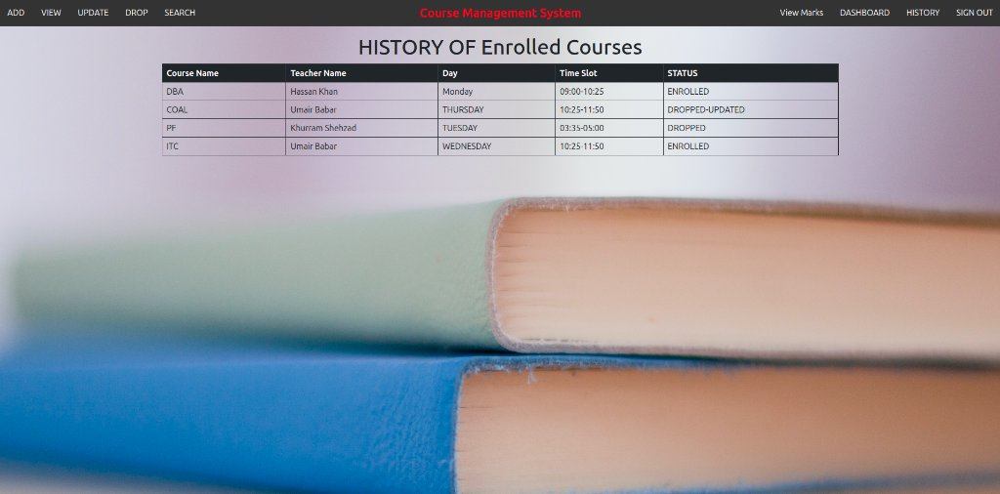
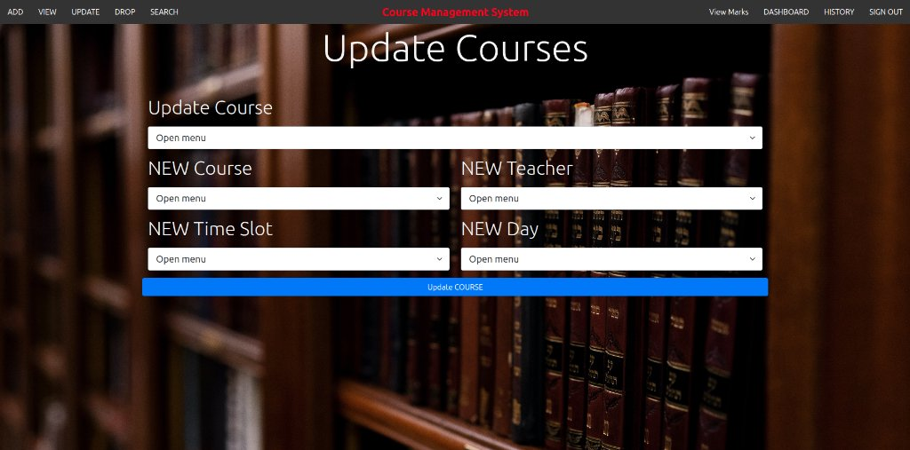
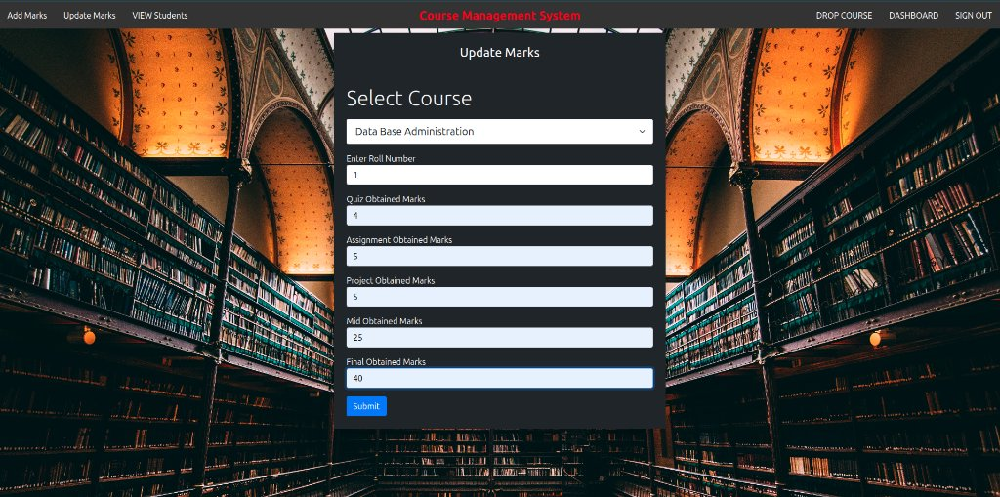

# CourseFlow | Course Management System (CMS)

A dual-portal academic management system for student course enrollment, schedule conflict prevention, and faculty grade and class management.

---

## ⚡ Quick Demo Accounts & Instant Testing

Pre-seeded trial credentials are available out-of-the-box for instant testing (no sign-up required):

| Role | Username | Password | Features Accessible |
| :--- | :--- | :--- | :--- |
| **Student** | `student` | `123456` | Course registration, schedule view, course drop/search, semester grades |
| **Teacher** | `teacher` | `123456` | View enrolled students, enter/update exam marks, drop student courses |

*(Pre-seeded with a sample course `DBA` taught by instructor `Hassan Khan` and test grades).*

### How to Test in 30 Seconds:
1. Start the app: `docker compose up --build` *(or `sudo docker compose up --build` on Linux)*.
2. Open [http://localhost:8080/](http://localhost:8080/) in your browser and click **SIGN IN**.
3. Log in as **`student`** (`123456`) to view active courses, test schedule updating, or inspect grades.
4. Log out and log in as **`teacher`** (`123456`) to view enrolled students, enter marks, or drop courses.

---

## 📸 Application Screenshots

Visual previews of the application portals for quick reference:

### 🎓 Student Portal

#### 1. Academic History & Enrolled Courses
Students can inspect their real-time enrollment statuses (`ENROLLED`, `DROPPED`, `DROPPED-UPDATED`) alongside instructor schedules:


#### 2. Course Schedule Updates
Allows students to update course selections, assigned teachers, lecture time slots, and days:


#### 3. Custom Course Search
Lookup specific courses and assigned faculty details directly from the student dashboard:


---

### 👨‍🏫 Teacher / Faculty Portal

#### Student Grade & Marks Management
Faculty members can record and update evaluation scores (Quizzes, Assignments, Projects, Midterm, and Final exams) for each enrolled student by roll number:


---

## Features

### Student Portal
- **User Authentication**: Secure sign-up, sign-in, and session management.
- **Course Registration**: Add courses with real-time schedule conflict and duplicate enrollment detection.
- **Course Management**: Update or drop enrolled courses.
- **Course Search**: Custom lookup tool for enrolled courses and instructors.
- **Academic History & Grades**: View past enrollment history and semester grades across all evaluation categories (Quizzes, Assignments, Projects, Midterms, Finals).

### Teacher / Faculty Portal
- **Faculty Registration & Login**: Dedicated authentication for instructors.
- **Student Enrollment Review**: Inspect enrolled student lists by course.
- **Grading Management**: Enter and update marks for quizzes, assignments, projects, midterms, and finals.
- **Enrollment Oversight**: Drop student enrollments when necessary.

### Security & Architecture
- **Parameterized Queries**: All database operations use `PreparedStatement` to protect against SQL Injection.
- **Unified Database Access**: Centralized database connection management via `DBConnection.java`.
- **Session Validation**: Role-based access control preventing unauthenticated access to student and faculty portals.
- **Execution-After-Redirect (EAR) Protection**: Guarded JSP redirects to ensure restricted views cannot be fetched without valid session credentials.

---

## Tech Stack

- **Backend**: Java Servlets, JSP (Java EE / Jakarta Servlet API)
- **Database**: MySQL 8.x / 5.7 (with `mysql-connector-java`)
- **Web / Application Server**: Apache Tomcat 9+
- **Frontend**: HTML5, CSS3, JavaScript, Bootstrap 5

---

## Project Structure

```text
CMS/
├── add.jsp                 # Student course registration view
├── addMarks.jsp            # Faculty mark entry view
├── custom.jsp              # Student course search view
├── dashboard.jsp           # Student dashboard
├── drop.jsp                # Student course drop view
├── dropCourse.jsp          # Faculty course drop view
├── forgot.html             # Account recovery page
├── header.html             # Student navigation header
├── home.html               # Main landing page (welcome file)
├── role.html               # Role selection view (Student vs Teacher)
├── signin.html             # Login view
├── signup.html             # Student sign-up form
├── teacher_dashboard.jsp   # Faculty dashboard
├── teacher_header.html     # Faculty navigation header
├── teacher_signup.html     # Faculty sign-up form
├── update.jsp              # Course schedule update view
├── updateMarks.jsp         # Faculty marks update view
├── viewStudents.jsp        # Enrolled student list view
├── database.sql            # Ready-to-import MySQL database schema
├── Dockerfile              # Docker container configuration for cloud deployment
├── docker-compose.yml      # Multi-container orchestration (App + MySQL)
├── css/                    # Custom stylesheets and Bootstrap CSS
├── images/                 # Theme and background assets
│   └── screenshots/        # Application preview screenshots
├── script/
│   └── script.js           # Client-side validation scripts
└── WEB-INF/
    ├── web.xml             # Servlet mappings, welcome file list
    ├── lib/                # MySQL JDBC driver jar
    └── classes/            # Servlets and DBConnection utility
```

---

## 🗄️ Database Schema

The database structure and pre-seeded test records are defined in [`database.sql`](database.sql). When launched with Docker, this file is automatically imported on container startup.

| Table | Purpose |
| :--- | :--- |
| `data` | User credentials, profiles, and roles (`student` vs `teacher`) |
| `add_course` | Active course registrations, lecture schedules, and teacher mappings |
| `marks` | Continuous assessment marks (Quizzes, Assignments, Midterms, Finals) |
| `history` | Audit log tracking enrolled and dropped course histories |

---

## Configuration

Database credentials are centrally managed in `WEB-INF/classes/DBConnection.java` (defaulting to local `127.0.0.1/project` with username `root` and password `root`). If your local MySQL uses a different username or password, update them in that file.

---

## Quickstart with Docker (Recommended)

No need to install Java, Apache Tomcat, or MySQL. If Docker is installed on your machine:

1. **Clone and Start**:
   ```bash
   git clone <repo-url>
   cd CMS
   docker compose up --build
   ```
   *(Note: On Linux, use `sudo docker compose up --build` if your current user is not in the `docker` group).*
2. **Access the Application**:
   Open your browser and navigate to:
   ```
   http://localhost:8080/
   ```
   *The database schema (`database.sql`) is automatically imported, and all Java servlets are compiled on startup.*

To stop the containers:
```bash
docker compose down
```

---

